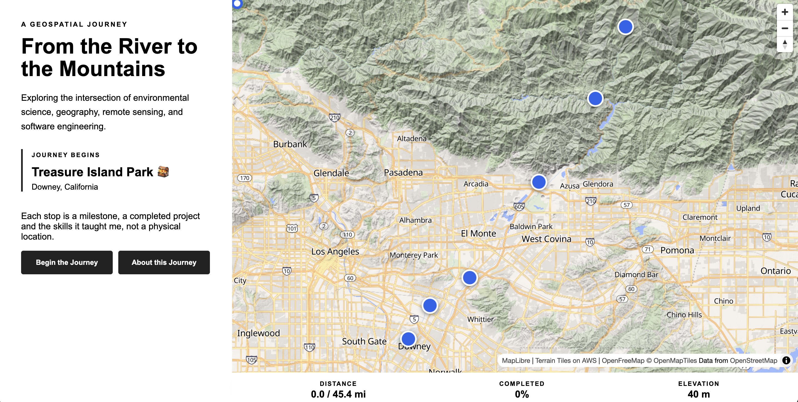

# GeoJourney



An interactive geospatial portfolio experience that visualizes my journey from **Treasure Island Park in Downey, California, to Crystal Lake Recreation Area in the San Gabriel Mountains**.

GeoJourney combines GIS, web mapping, environmental science, remote sensing, and software engineering into an interactive map-based portfolio.

**Live site:** https://geo-journey-ke15jmn1n-coding-temple1.vercel.app/

## Project Overview

GeoJourney is designed as more than a traditional portfolio. Instead of presenting projects as a static list, the application uses a real-world route to create an interactive geospatial journey.

As the journey progresses, portfolio projects appear as geographic milestones along the route. A moving journey marker follows the route across a 3D terrain map while a progress bar tracks the miles traveled, the percentage completed, and the current elevation.

The concept is personal: I have never owned a car, which made the outdoors hard to reach. The route stands for my career. The early miles are flat and steady, and the path gets steeper toward the mountains, just as my projects grow more challenging. The campground is where the effort pays off.

### Journey

- **Starting Point:** Treasure Island Park, Downey, California
- **Destination:** Crystal Lake Recreation Area, San Gabriel Mountains

The route was generated using **BRouter** and imported into the application as GeoJSON data.

### Stops Are Milestones, Not Locations

The portfolio stops are **project milestones**, not the physical locations of the projects. Each stop represents a group of completed projects and the skills learned from them. The map, the introduction panel, and the About panel all explain this to visitors.

## Current Features

### Interactive 3D Map

- MapLibre GL JS interactive map
- OpenFreeMap Liberty basemap
- 3D terrain built from free AWS Terrain Tiles elevation data
- Hillshade layer that shades the slopes
- Camera tilt when the journey begins
- Map zooms out to show the full route and every stop when the page loads
- Zoom and navigation controls
- Responsive two-column layout (introduction panel on the left, map and progress bar on the right), stacked on phones
- Custom journey and portfolio markers, snapped onto the route line

### Journey Introduction

The application begins with an introductory panel describing the purpose of the journey and explaining that stops are milestones.

The **Begin the Journey** button:

1. Flies the map to Treasure Island Park and tilts the camera.
2. Starts the route animation.
3. Moves the journey marker along the route.
4. Progressively draws the route.

The **About this Journey** button opens the About panel.

### About Panel

The About panel tells the story behind the route and the project, explains the milestone concept, summarizes my background in environmental studies, geography, remote sensing, and software engineering, and links to my resume and LinkedIn profile.

### Real Route Animation

The journey follows a BRouter-generated route rather than a manually drawn line.

The route includes:

- Bike paths
- Shared-use paths
- Streets
- Mountain roads

The route is stored as GeoJSON and converted into TypeScript data used by the application.

### Portfolio Stops and Projects

The 14 portfolio projects are organized into four milestone stops, ordered from foundational skills on the flat river miles to advanced applied work on the final climb.

| Stop | Milestone | Projects |
|---|---|---|
| Start | Treasure Island Park | Starting point |
| 1 | Mapping Fundamentals | Georeference and Digitize, Map Elements, Annotation |
| 2 | Design, CAD & Terrain | Digital Illustration Design, Working with CAD, AutoCAD Designs, Deriving Surfaces from CAD |
| 3 | Remote Sensing | Band Combinations, NDVI using Red and Red Edge, Supervised Image Classification, Height Profile |
| 4 | Web & Applied GIS | Storymap, Dashboard (Guardrail End Treatments), Field Application (Sedona Lightning Strikes Web App) |
| End | Crystal Lake Recreation Area | Destination |

Portfolio stops automatically pause the journey when the moving marker reaches them. Stops are detected by matching each stop to its nearest point on the route, so the stops open in the order the route reaches them.

### Interactive Project Panels

Selecting a milestone stop opens a panel that lists every project in that group. Each project can include:

- Project title and description
- Technologies used
- A preview image that opens full size in a new tab
- Buttons that open supporting files (images and PDFs) in a new tab
- A project link, when available

The panel also includes a **Continue Journey** button. The destination displays a **Journey Complete** state.

### Journey Progress Bar

A progress bar at the bottom of the page replaces the original elevation line graph. It shows:

- **Distance:** miles traveled out of the total route miles
- **Completed:** percentage of the route completed
- **Elevation:** current elevation in meters

Distance is calculated cumulatively along the route using great-circle (haversine) distance, so the percentage follows actual distance rather than the number of points in the route file. Elevation is interpolated between the elevation values stored in the route coordinates. The 3D terrain on the map now shows the climb visually.

## Technology Stack

### Front End

- React
- TypeScript
- Vite
- HTML
- CSS

### Mapping and Geospatial

- MapLibre GL JS
- OpenFreeMap
- AWS Terrain Tiles (elevation data for 3D terrain and hillshade)
- BRouter
- GeoJSON

### Development and Deployment

- Node.js
- Git and Git LFS
- GitHub and GitHub Actions (continuous integration)
- Vercel (deployment)
- VS Code

## Project Structure

```text
geojourney/
├── .github/
│   └── workflows/
│       └── ci.yml
├── public/
│   ├── projects/                  # project preview images and supporting files
│   ├── designCadTerrain/          # project PDFs
│   └── resume/                    # resume PDF
├── src/
│   ├── components/
│   │   ├── About/
│   │   │   └── AboutPanel.tsx
│   │   ├── Intro/
│   │   │   └── BeginningSection.tsx
│   │   ├── Map/
│   │   │   └── JourneyMap.tsx
│   │   └── Stats/
│   │       └── JourneyStats.tsx
│   ├── data/
│   │   ├── brouter-route.geojson
│   │   ├── journeyRoute.ts
│   │   └── journeyStops.ts
│   ├── types/
│   │   └── journey.ts
│   ├── utils/
│   │   ├── mapView.ts
│   │   └── routeStats.ts
│   ├── App.tsx
│   └── index.css
├── package.json
├── tsconfig.json
└── vite.config.ts
```

## Geospatial Data

The journey route was generated using BRouter and exported as GeoJSON. The route data is stored in `src/data/brouter-route.geojson` and converted into application-ready TypeScript data in `src/data/journeyRoute.ts`.

The route coordinates use the following structure:

```text
[longitude, latitude, elevation]
```

The application uses the route geometry and elevation values for:

- Route rendering
- Journey animation
- Stop detection
- Cumulative distance and percent-complete calculations
- Elevation readout in the progress bar
- Fitting the map view to the full route

### Key Coordinates

**Starting point — Treasure Island Park**

```text
[-118.1376, 33.9564]
```

**Approximate destination**

```text
[-117.83, 34.322]
```

**BRouter route endpoint**

```text
[-117.830431, 34.321845]
```

The approximate destination coordinates and the generated route endpoint differ slightly. The route endpoint represents the end of the generated route geometry.

Milestone stop coordinates in `journeyStops.ts` are approximate. At runtime each stop is snapped to the nearest vertex on the route, so its marker always sits on the route line.

## Data Sources and Methodology

This section documents the sources, processing workflow, and limitations of the geospatial data used in GeoJourney.

### Route Geometry and Routing

BRouter was used to generate the route between the starting point and destination. The route was exported as GeoJSON and incorporated into the application.

- **Routing service:** [BRouter](https://brouter.de/brouter-web/)
- **Original route file:** `src/data/brouter-route.geojson`
- **Application route data:** `src/data/journeyRoute.ts`
- **Route geometry:** GeoJSON LineString
- **Coordinate structure:** Longitude, latitude, and elevation, where elevation is present

The route geometry supplies the coordinates used to progressively draw the route, move the journey marker, and calculate distance traveled.

The generated route is approximately **73.1 km (45.4 miles)** long, with approximately **1,944 m (6,378 ft) of ascent** according to the route metadata previously recorded during development. These figures should be verified against the current route file and its generation settings before being treated as final published statistics.

### Basemap and Mapping Technology

GeoJourney uses the OpenFreeMap Liberty style to display the interactive basemap. MapLibre GL JS renders the map and provides the client-side mapping functionality.

- **Basemap style and tile service:** [OpenFreeMap](https://openfreemap.org/)
- **Style URL:** `https://tiles.openfreemap.org/styles/liberty`
- **Mapping library:** [MapLibre GL JS](https://maplibre.org/)
- **Route format:** GeoJSON
- **Route visualization:** MapLibre line layer

MapLibre is the mapping technology used to render and interact with the map; it is not the original source of the route geometry.

### Terrain and Elevation

Two separate elevation sources are used, for different purposes:

- **3D terrain and hillshade:** [AWS Terrain Tiles](https://registry.opendata.aws/terrain-tiles/), loaded as raster elevation tiles in the Terrarium encoding. They give the map its 3D relief and slope shading. The terrain is exaggerated (1.4x) to make the relief easier to see.
- **Elevation readout:** the elevation values stored in the route coordinates, interpolated between points as the marker moves.

Because these are two different sources, the elevation shown in the progress bar may differ slightly from the elevation of the 3D terrain at the same point.

Elevation values and ascent statistics are estimates. They should not be interpreted as independently surveyed measurements. The underlying elevation-data provider and any elevation processing applied by the routing service should be confirmed when available.

### Data Processing Workflow

The geospatial data workflow is:

1. Generate the route using BRouter.
2. Export the route geometry as GeoJSON.
3. Store the original route in `src/data/brouter-route.geojson`.
4. Convert the route into application-ready TypeScript data in `src/data/journeyRoute.ts`.
5. Load the route into MapLibre GL JS for progressive route rendering and marker animation.
6. Calculate cumulative distance along the route (`src/utils/routeStats.ts`) for the miles and percent-complete readout.
7. Snap each portfolio stop to its nearest route vertex so stops trigger in route order.

This workflow separates the source route data from the application logic that visualizes it.

### Data Limitations

The route is a generated visualization connecting the portfolio's starting point and destination. It includes a mixture of paths, streets, and mountain roads.

The route should not be interpreted as a verified, safe, or currently accessible cycling route. Road conditions, path access, closures, surface types, and route suitability have not necessarily been independently verified.

Portfolio stops represent milestones in the developer's project journey rather than the physical locations of the featured projects.

### Attribution, Licensing, and Reproducibility

The project retains attribution for its data sources on the map, including the basemap and the terrain tiles, and should comply with the applicable licensing terms for the routing service, underlying geographic data, basemap, and elevation datasets.

For reproducibility, document the following details as they are verified:

- Date the route was generated or downloaded
- BRouter routing profile and relevant configuration
- Original route export format
- Data conversion and processing steps
- Underlying road-network and elevation-data sources, where available
- Applicable attribution and licensing requirements

The exact date, routing profile, and underlying elevation-data provider for the route have not yet been confirmed in this README and should not be inferred.

## Application Architecture

The application uses React state and callbacks to connect the map, journey animation, project panels, About panel, and progress bar.

The data flow is:

```text
BRouter GeoJSON
       |
       v
journeyRoute.ts
       |
       +------------------+
       v                  v
  JourneyMap          routeStats.ts
       |                  |
       v                  v
 Route Animation ----> JourneyStats (bottom progress bar)
       |
       v
 Portfolio Stops (snapped to the route)
       |
       v
 Project Panel (projects, images, files)
```

The journey animation calculates miles traveled, percent complete, and elevation on every frame and passes them from `JourneyMap` to `App.tsx`, which passes them to `JourneyStats`.

```tsx
<JourneyMap
  onMapReady={setMap}
  journeyStarted={journeyStarted}
  resumeJourney={resumeJourney}
  onStopSelect={handleStopSelect}
  onProgressChange={setStats}
/>

<JourneyStats stats={stats} />
```

### Stop Data Model

Each portfolio stop contains a list of projects. A project can include a description, technologies, a preview image, supporting files, and a link.

```typescript
export interface StopProject {
  name: string;
  description?: string;
  technology?: string[];
  projectUrl?: string;
  files?: ProjectFile[];
  image?: ProjectImage;
}
```

## Completed Development Milestones

The project has been developed incrementally through small, testable features.

### Map Foundation

- Built the initial GeoJourney map foundation
- Connected the journey button to map navigation
- Added route animation

### Portfolio Journey

- Added interactive project panels
- Added portfolio stop detection
- Added journey pause/resume functionality
- Added destination completion state
- Added custom journey markers
- Grouped 14 projects into four milestone stops
- Added project lists, preview images, and file buttons to the project panel
- Added the About panel and the milestone note in the introduction

### Routing

- Replaced an estimated route with a BRouter-generated route
- Adjusted route animation speed
- Replaced distance-threshold stop detection with route-snapped stops that trigger in route order
- Prevented repeated stop detection

### Terrain and Progress

- Added 3D terrain and hillshade from AWS Terrain Tiles
- Added automatic zoom-out to the full route on load
- Replaced the elevation line graph with a progress bar showing miles traveled, percent complete, and elevation in meters

### Layout and Styling

- Reorganized the layout into two columns, with the introduction panel beside the map and progress bar
- Reorganized and consolidated the stylesheet, including mobile styles

### Performance

- Split MapLibre into a separate JavaScript bundle
- Lazy-loaded the journey map component
- Added a loading fallback while the journey map component loads
- Compressed large project files and tracked the remaining large files with Git LFS

### Deployment

- Added a GitHub Actions workflow that lints and builds the project on every pull request and push to `main`
- Deployed the site on Vercel, with automatic deployments from the `main` branch

## Development

### Prerequisites

- Node.js
- npm
- Git
- Git LFS (for large project files)

### Installation

Clone the repository and navigate to the project directory:

```bash
git clone https://github.com/Stephanie-Ramos/GeoJourney.git
cd GeoJourney
```

If you have Git LFS installed, the large project files download with the clone. Otherwise, run `git lfs install` and then `git lfs pull`.

Install dependencies:

```bash
npm install
```

Start the development server:

```bash
npm run dev
```

Open the local development URL provided by Vite.

### Production Build

Run the TypeScript checks and create a production build:

```bash
npm run build
```

The production files are generated in the `dist/` directory. To test the built version locally:

```bash
npm run preview
```

### Adding Project Content

Project content lives in `src/data/journeyStops.ts`. Each milestone stop has a `projects` list; add a project's description, technologies, links, a preview image, and supporting files there. Image and file paths start with `/` and leave out the `public` folder name, for example `/projects/map-elements.pdf`.

### Large Files

Keep preview images small (a few hundred KB) and PDFs compressed. Files over 100 MB cannot be pushed to GitHub normally, so compress them first, or track them with Git LFS if they must stay large. When deploying to Vercel, enable Git Large File Storage in the project's Git settings so LFS files are served as real files.

## Current Development Status

GeoJourney currently includes:

- Interactive 3D MapLibre map with terrain and hillshade
- BRouter-generated route
- Animated journey marker and progressive route drawing
- Four milestone stops containing 14 portfolio projects
- Project panels with descriptions, technologies, preview images, and file buttons
- Automatic journey pauses and resume functionality
- Destination completion state
- About panel with resume and LinkedIn links
- Progress bar showing miles traveled, percent complete, and elevation
- Lazy-loaded journey map component with code splitting for MapLibre
- Continuous integration with GitHub Actions and deployment on Vercel

The next development phase focuses on finishing the project descriptions and technology lists, improving camera transitions, keyboard accessibility for stop markers, geospatial data validation, and the overall portfolio presentation.

## Project Goals

GeoJourney is being developed as a portfolio project demonstrating the intersection of:

**GIS + Geospatial Data + Web Mapping + Software Engineering + Environmental Science**

The project is intended to demonstrate practical experience with:

- Geospatial data structures
- GeoJSON
- Route data and visualization
- 3D terrain and elevation data
- Spatial relationships
- Map-based interfaces
- Interactive data visualization
- React component architecture
- TypeScript
- State management
- Asynchronous animation
- Responsive UI
- Accessible interaction patterns
- Continuous integration and deployment
- Geospatial data provenance and documentation
- Front-end performance optimization
